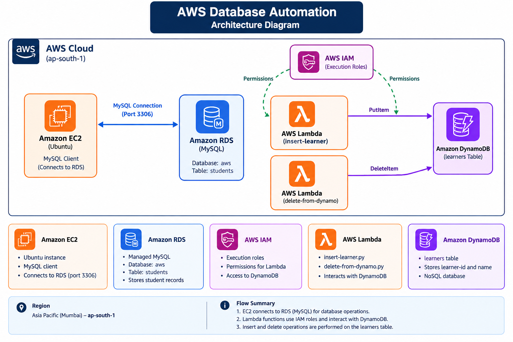

# AWS Database Integration and Serverless Automation

A hands-on AWS project demonstrating relational database connectivity, serverless data operations, NoSQL database management, and cloud resource integration using Amazon EC2, Amazon RDS for MySQL, AWS Lambda, Amazon DynamoDB, and AWS IAM.

## Project Overview

This project documents practical exercises completed on Amazon Web Services (AWS). It combines a relational database workflow with serverless automation to demonstrate how applications and managed AWS services can interact.

The project includes:

- Connecting to an Amazon RDS for MySQL database from an Ubuntu EC2 instance.
- Creating a database and table, inserting records, retrieving data, and deleting a record using MySQL.
- Creating an Amazon DynamoDB table to store learner records.
- Implementing an AWS Lambda function to insert learner records into DynamoDB.
- Implementing another Lambda function to delete learner records using their partition key.
- Testing both Lambda functions with event-based input and verifying the results in DynamoDB.
- Organizing source code, SQL scripts, architecture documentation, and practical screenshots.

**Region used:** Asia Pacific (Mumbai) — `ap-south-1`

## Architecture



### AWS Services Used

| Service | Purpose in This Project |
|---|---|
| Amazon EC2 | Ubuntu-based virtual machine used to connect to the MySQL database. |
| Amazon RDS for MySQL | Managed relational database used for SQL operations and persistence testing. |
| AWS Lambda | Runs Python functions for inserting and deleting DynamoDB records. |
| Amazon DynamoDB | NoSQL database used to store learner records. |
| AWS IAM | Controls permissions granted to the Lambda execution roles. |

## Practical 1: EC2 and Amazon RDS Connectivity

### Objective

Connect to a managed MySQL database hosted on Amazon RDS from an Ubuntu EC2 instance.

### Implementation

1. Launched and accessed an Ubuntu EC2 instance.
2. Installed the MySQL command-line client.
3. Connected to the RDS MySQL endpoint using the database username and password.
4. Created a database named `aws`.
5. Created a `students` table with `id` and `name` columns.
6. Inserted sample records and retrieved them using SQL queries.
7. Deleted a record and verified the remaining data.
8. Reconnected to MySQL and verified that the remaining record persisted.

### MySQL Commands

Install the client:

```bash
sudo apt update
sudo apt install mysql-client -y
```

Connect to the RDS instance:

```bash
mysql -u admin -h <RDS-ENDPOINT> -P 3306 -p
```

Replace `<RDS-ENDPOINT>` with your RDS endpoint. Enter the database password when prompted.

### SQL Operations

```sql
CREATE DATABASE IF NOT EXISTS aws;
USE aws;

CREATE TABLE IF NOT EXISTS students (
    id INT PRIMARY KEY,
    name VARCHAR(100)
);

INSERT INTO students (id, name)
VALUES (1, 'Soumya'), (2, 'Barik');

SELECT * FROM students;

DELETE FROM students
WHERE id = 2;

SELECT * FROM students;
```

### Outcome

Successfully connected to Amazon RDS from EC2, executed SQL CRUD operations, and verified that the remaining data persisted after reconnecting.

## Practical 2: DynamoDB Table Setup

### Objective

Create a managed NoSQL table for storing learner information.

### Configuration

| Setting | Value |
|---|---|
| Table name | `learners` |
| Partition key | `learner-id` |
| Partition key type | String |
| Capacity mode | On-demand |
| AWS Region | `ap-south-1` |

### Data Model

Each learner item contains:

- `learner-id` — unique partition-key value for identifying the learner.
- `name` — learner's name.

Example item:

```json
{
  "learner-id": "1",
  "name": "Soumya"
}
```

### Outcome

Created the DynamoDB table and verified learner items through the AWS Management Console.

## Practical 3: Lambda Function for Inserting Learners

### Objective

Use an AWS Lambda function to insert learner data into DynamoDB from an event payload.

### Configuration

- **Function name:** `insert-learner`
- **Runtime:** Python 3.14
- **Execution role:** `insert-learner-role-a8hmegqj`
- **DynamoDB table:** `learners`

### Implementation

The function reads `learner-id` and `name` from the event and writes the item to DynamoDB using the Boto3 SDK.

```python
import json
import boto3

dynamodb = boto3.resource('dynamodb')
table = dynamodb.Table('learners')

def lambda_handler(event, context):
    learner_id = event['learner-id']
    name = event['name']

    table.put_item(
        Item={
            'learner-id': learner_id,
            'name': name
        }
    )

    return {
        'statusCode': 200,
        'body': json.dumps('Learner added successfully!')
    }
```

### Test Event

```json
{
  "learner-id": "2",
  "name": "Rahul"
}
```

### Verification

Tested the function with event-based input and verified the inserted learner in the DynamoDB table.

## Practical 4: Lambda Function for Deleting Learners

### Objective

Delete a learner item from DynamoDB using its partition key.

### Configuration

- **Function name:** `delete-from-dynamo`
- **Runtime:** Python 3.14
- **Execution role:** `delete-from-dynamo-role-1kof3ji6`
- **DynamoDB table:** `learners`

### Implementation

```python
import json
import boto3

dynamodb = boto3.resource('dynamodb')
table = dynamodb.Table('learners')

def lambda_handler(event, context):
    learner_id = event['learner-id']

    table.delete_item(
        Key={
            'learner-id': learner_id
        }
    )

    return {
        'statusCode': 200,
        'body': json.dumps(
            f'Learner {learner_id} deleted successfully!'
        )
    }
```

### Test Event

```json
{
  "learner-id": "2"
}
```

### Verification

The deletion test completed successfully. The DynamoDB table was checked afterward, confirming that learner `2` was removed while learner `1` (`Soumya`) remained.

## IAM Permissions and Security

IAM execution roles were configured for the Lambda functions. During these practicals, the AWS managed policy `AmazonDynamoDBFullAccess` was attached to each execution role to enable the demonstrated DynamoDB operations.

**Security improvement for production:** Replace broad permissions with a least-privilege policy scoped to the required table and actions. Do not commit AWS access keys, secret keys, database passwords, private keys, or credential files to source control.

The `.gitignore` file excludes common credential files, private-key extensions, and Python-generated files. This is a safeguard, not a substitute for checking files before publishing.

## Repository Structure

```text
aws-database-automation/
├── architecture/
│   └── aws-architecture.png
├── Lambda and dynamoDB/
│   ├── insert-learner.py
│   └── delete-from-dynamo.py
├── mysql-scripts/
│   └── students.sql
├── screenshots/
│   ├── DynamoDB table and items/
│   ├── EC2 and RDS connectivity/
│   ├── Lambda insert and delete test results/
│   └── MySQL queries and output/
├── .gitignore
└── README.md
```

## Evidence and Screenshots

The `screenshots/` directory contains evidence captured during the practical exercises.

- **EC2 and RDS connectivity:** Database connection and configuration evidence.
- **MySQL queries and output:** SQL operations and query results.
- **DynamoDB table and items:** Table setup and stored learner records.
- **Lambda insert and delete test results:** Function execution and verification evidence.

These screenshots help document the actual implementation and test results.

## Key Learning Outcomes

Through this project, I practised:

- Connecting an EC2 Linux environment to a managed relational database.
- Using the MySQL CLI for database and table operations.
- Understanding the difference between relational databases and NoSQL databases.
- Working with DynamoDB partition keys and item-level operations.
- Writing Python Lambda functions using the Boto3 SDK.
- Passing JSON event payloads to serverless functions.
- Configuring IAM execution roles and understanding permission scope.
- Verifying changes through the AWS Management Console and database queries.
- Organizing code and practical evidence in a version-controlled project.

## Current Scope

This repository documents completed database integration and serverless automation exercises. It does not claim to implement an API Gateway endpoint, a public web application, a full CI/CD pipeline, Terraform provisioning, or production-grade monitoring.

## Future Improvements

Potential extensions include:

- Replace broad IAM policies with least-privilege permissions.
- Add input validation and structured error handling to Lambda functions.
- Add automated tests for database operations.
- Add infrastructure as code using Terraform or AWS CloudFormation.
- Introduce API Gateway if HTTP-based access is required.
- Add logging, monitoring, and alerts using Amazon CloudWatch.

## Disclaimer

This project is intended for learning and demonstration. AWS resources may incur charges. Review and delete resources that are no longer needed, while preserving any resources required for ongoing practice.

---

**Author:** `soumyaranjan-dev57`  
**Focus:** AWS Cloud, Database Integration, Serverless Computing, Python

